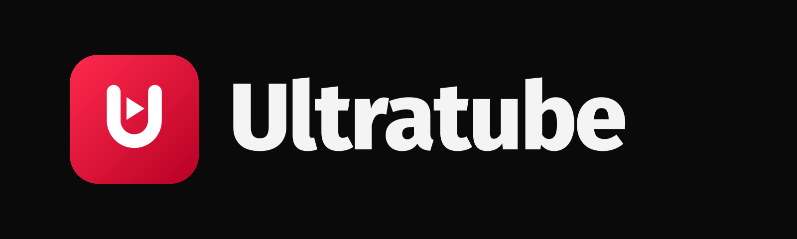
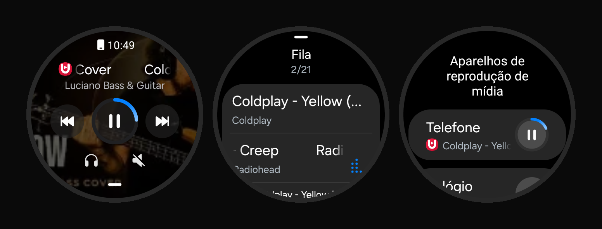

<p align="center">
  
</p>

<p align="center">
  <b>YouTube, YouTube Music e Twitch sem anúncios — no celular Android e no Galaxy Watch.</b><br>
  Sem conta Google obrigatória: inscrições, histórico, playlists e downloads ficam no aparelho.
</p>

<p align="center">
  
</p>

| App | Pacote | Versão | Testado em |
|---|---|---|---|
| Celular (Flutter) | `app.ultratube.mobile` | 1.0.7 | Galaxy S23 (Android 16) |
| Relógio (Kotlin, Wear OS) | `app.ultratube.wear` | 0.5.1 | Galaxy Watch 7 (SM-L300) |
| Desktop (Flutter) | — | — | Windows, macOS e Linux via GitHub Actions (ainda não visto rodando) |
| iOS (Flutter) | — | — | `.ipa` sem assinatura via GitHub Actions (ainda não testado num iPhone) |

## Destaques

- **Sem anúncios, sem WebView do YouTube**: extração própria (NewPipeExtractor + cliente do app) e
  player MediaKit/mpv no celular, Media3 no relógio.
- **Só áudio de verdade**: só a faixa de áudio é baixada, com qualidade econômica (~50 kbps),
  normal ou alta; a escolha vale para todos os vídeos.
- **Shorts** no feed real do YouTube (o da sua conta quando conectada), com puxar para atualizar.
- **Twitch sem anúncios**: um proxy HLS local remove os intervalos comerciais; chat com emotes.
- **Galaxy Watch dos dois jeitos**: um app próprio que toca sozinho (Wi-Fi/LTE) **e** controle
  completo do Ultratube do celular pelo relógio — inclusive a fila.

## Recursos

### Celular

- **Início**: "Para você" (com conta, o Início do YouTube da conta; sem conta, inscrições +
  "a seguir" do que você viu), abas Música, Ao vivo, Games e Podcasts.
- **Busca** com sugestões e filtros (vídeos, Shorts, músicas, canais, playlists, álbuns).
- **Assistir**: até 4K, toque duplo ±10 s, tela cheia, descrição, comentários, "A seguir" com
  reprodução contínua e fila estilo YouTube (arrastar, embaralhar, repetir, salvar como playlist).
- **Só áudio**, **qualidade do áudio** e **economia na rede móvel** (fora do Wi-Fi: vídeo até
  480p e áudio econômico). Com o app em segundo plano sem janela flutuante, a imagem deixa de ser
  baixada e só o áudio continua.
- **Janela flutuante (PiP)** no formato do vídeo (vertical nos Shorts).
- **Shorts**: feed vertical, troca rápida (os próximos já ficam prontos), comentários, curtidas,
  puxar para baixo ou ⟳ para um feed novo.
- **SponsorBlock** automático (patrocínio, autopromoção, pedidos de inscrição).
- **Downloads offline**: áudio M4A ou vídeo 480p/720p/1080p, com capa, em segundo plano.
- **Lives do YouTube** com chat sobre o vídeo e contador de espectadores.
- **Twitch**: seguindo (com ou sem conta, entrada por twitch.tv/activate), ao vivo agora,
  categorias, VODs e chat com emotes 7TV/BTTV.
- **Perguntar (Gemini)**: resumo e explicação do vídeo com marcas de tempo, usando a chave do
  Google AI Studio do próprio usuário.
- **Conta do YouTube opcional** (página normal de login do Google, sem chave de API) e
  importação de inscrições (Google Takeout, NewPipe, LibreTube).
- Letras via LRCLIB.

### Relógio controlando o celular (sem o app do relógio)

O Ultratube do celular publica uma sessão de mídia completa, que o controle de mídia do Galaxy
Watch (e fones, carro, tela de bloqueio) usa:

- capa, título e canal; tocar/pausar, anterior/próximo, ±10 s e volume;
- **a fila do celular aparece no relógio** — tocar um item troca a música no celular;
- nos **Shorts**, próximo/anterior passam o feed, e "anterior" no primeiro Short traz um feed novo;
- em **lives**, a barra de progresso some (não há linha do tempo);
- funciona com o celular bloqueado no bolso: o pedido de play mantém o app com rede em
  segundo plano.

<p align="center">
  
</p>

### App do relógio (Galaxy Watch)

- **Independente**: toca sem o celular por perto, com tela apagada e áudio continuando.
- Busca por voz ou texto; Músicas · Vídeos (até 360p) · Shorts.
- **Shorts** no feed real do YouTube, deslizando para cima/baixo; puxar no primeiro ou
  "Atualizar" traz Shorts novos.
- **Conta do YouTube pelo celular**: o Wear OS não abre a página de login do Google, então o
  celular já conectado envia a sessão pelo Wi-Fi, cifrada (QR ou código em Você › Conectar
  relógio). Traz Para você, Inscrições e os Shorts da conta.
- Twitch ao vivo sem anúncios, lives do YouTube, letra, fila, favoritos, downloads offline e timer
  para pausar (15–90 min). Ícone no mostrador enquanto toca (*Ongoing Activity*).

<p align="center">
  
</p>

Todos os prints (28 do celular, 23 do relógio), o logo e as imagens de destaque estão em
[`docs/portfolio/`](docs/portfolio/README.md).

## Como funciona

```
                 ┌──────────────── android/media (Kotlin) ────────────────┐
                 │ Catalog · PlayerFallback · AudioQuality · YoutubeAccount │
                 │ Downloads · Twitch · WatchLink                           │
                 └───────────────┬──────────────────────────┬─────────────┘
                                 │ plugin (MethodChannel)    │ chamada direta
          ┌──────────────────────▼──────┐        ┌──────────▼─────────────────┐
          │ Celular — Flutter (ppplayer)│        │ Relógio — Kotlin (wear)     │
          │ MediaKit/mpv · audio_service │  Wi-Fi │ Media3/ExoPlayer · Views    │
          │ sessão de mídia ─────────────┼───BT──▶│ controle de mídia do Watch  │
          │ "Conectar relógio" ──────────┼──AES──▶│ "Entrar com o celular"      │
          └──────────────────────────────┘        └────────────────────────────┘
```

## Código compartilhado

Celular (Flutter) e relógio (Kotlin) são apps diferentes, mas a lógica que não é tela
fica num lugar só:

| O quê | Onde | Usado por |
|---|---|---|
| Busca, canais, playlists, extração de streams (NewPipe + cliente do app), Shorts rápidos | `android/media/Catalog.kt`, `PlayerFallback.kt` | celular (via `UltratubeCatalogPlugin`) e relógio |
| Escolha da faixa de áudio (econômica/normal/alta, faixa original) | `AudioQuality.kt` | os dois |
| Conta do YouTube (InnerTube com cookies), feed de Shorts, Para você, inscrições | `YoutubeAccount.kt` | os dois |
| Entrar no relógio pelo celular (protocolo cifrado) | `WatchLink.kt` (+ `AccountLink.kt` no relógio, `WatchLinkActivity.kt` no celular) | os dois |
| Letras (LRCLIB, limpeza do título) | `Catalog.lyrics` | os dois |
| Downloads offline | `Downloads.kt`, `DownloadService.kt` | os dois |
| Versões das bibliotecas | `android/gradle/libs.versions.toml` | as duas builds Gradle (o celular importa o arquivo) |

O que é de propósito separado:

- **Ports em Dart** (`ppplayer/lib/core/api/dart_catalog.dart`, `ultratube/dart_account.dart`):
  só existem para o iOS, que não roda Kotlin. Seguem as mesmas regras e formatos JSON do
  Kotlin; ao mudar uma regra em `android/media`, mude também o port.
- **Twitch**: o celular usa o proxy em Dart (`lib/core/twitch/`), que também roda no iOS; o
  relógio usa `Twitch.kt` dentro do player Media3. Mesma técnica, dois players diferentes.
- **SponsorBlock**: só no celular (`lib/core/api/sponsorblock.dart`).
- **Players**: MediaKit/mpv no celular, Media3/ExoPlayer no relógio, cada um com seu cache
  de URLs (`UltratubeResolveCache` e `Streams`).
- **Telas e tokens visuais**: Flutter (`UT`) e Views do relógio (`Ut`) usam os mesmos
  valores, cada um no seu toolkit.

## Estrutura

```
ppplayer/                app do celular (fork Flutter do PPPlayer) — também gera iOS e desktop
android/media/           biblioteca nativa compartilhada pelo celular e pelo relógio
android/wear/            app do Galaxy Watch (Wear OS)
android/gradle/libs.versions.toml   versões das bibliotecas, usadas pelas duas builds
docs/DIARIO.md           diário de cada rodada de desenvolvimento e testes no aparelho
docs/portfolio/          prints, logo e imagens de destaque
docs/verificacao/        evidências antigas de teste no relógio
.github/workflows/       builds do iOS (sem assinatura) e do desktop (disparo manual)
```

O build Android do celular inclui `android/media` como módulo Gradle
(`ppplayer/android/settings.gradle.kts`), então as duas pastas precisam ficar lado a lado.

## De onde veio

O app do celular é um **fork do [PPPlayer](https://github.com/ppplayer-labs/app)** (Flutter), a
partir do commit `6cea891`. Sobre essa base o Ultratube tirou todos os anúncios (Google Mobile
Ads e o player/WebView do YouTube, trocados por extração própria + MediaKit), ganhou identidade
própria (nome, ícone, tema preto OLED + vermelho) e tudo o que está acima. O app do relógio e a
biblioteca `android/media` são código novo, escritos para o Ultratube.

## Compilar

Requisitos: Flutter (Dart ≥ 3.12), **JDK 17** (o Gradle do relógio não roda no JDK 25) e Android SDK 35. O `local.properties` e as
chaves de assinatura não são versionados.

```sh
# celular
cd ppplayer
flutter pub get
flutter build apk --release      # ou: flutter run

# relógio
cd android
./gradlew :wear:assembleDebug
adb -s <relógio> install -r wear/build/outputs/apk/debug/wear-debug.apk
```

No Windows, o `flutter pub get` precisa do Modo de Desenvolvedor ligado (links simbólicos).
Para o build release assinado, crie `ppplayer/android/key.properties` com `storeFile`,
`storePassword`, `keyAlias` e `keyPassword`; sem ele, o release usa a chave de debug.

**iOS**: GitHub Actions › *Ultratube iOS (unsigned IPA)* gera um `.ipa` sem assinatura para
instalar com Sideloadly/AltStore. No iOS o catálogo é um port em Dart
(`ppplayer/lib/core/api/`). Ainda não foi testado num iPhone.

## Limites conhecidos

- Play pelo relógio/fone **com o app encerrado pelo sistema** ainda não inicia: o motor Flutter
  sobe e resolve o stream, mas o player mpv só termina de inicializar com a tela do app. Com o
  app aberto ou em segundo plano (o caso normal), funciona — inclusive com o celular bloqueado.
- Alguns Shorts voltam como indisponíveis no NewPipeExtractor v0.27.1 e são pulados (o link
  rápido recusado é tentado de novo pela extração completa antes).
- Celular e relógio usam a mesma sessão do YouTube; se o Google renovar os cookies em um deles,
  o outro pode precisar conectar de novo.
- A Twitch só deixa listar as 30 maiores lives em "Ao vivo agora" sem token de integridade.
- A aba Música do Início usa uma busca de reserva desde que o YouTube parou de responder ao
  gráfico de música do NewPipe (11/2026).
- Ainda falta testar: Perguntar com chave real, bateria e Bluetooth no relógio, iOS e desktop.
  Detalhes em [`docs/DIARIO.md`](docs/DIARIO.md).

## Licença

- Código novo em `android/` e a distribuição Android/Wear combinada: **GPL-3.0-or-later**
  (usa NewPipeExtractor, GPL-3.0). Veja `android/LICENSE` e `android/NOTICE.md`.
- `ppplayer/`: licença do PPPlayer preservada em `ppplayer/COPYING` e `ppplayer/assets/LICENSE`;
  notas do fork em `ppplayer/ULTRATUBE-NOTICE.md`.
- Media3 e OkHttp: Apache-2.0.

Ao distribuir um APK, o código-fonte correspondente precisa estar disponível (este repositório).
Projeto pessoal, sem relação com o Google, o YouTube ou a Twitch.
