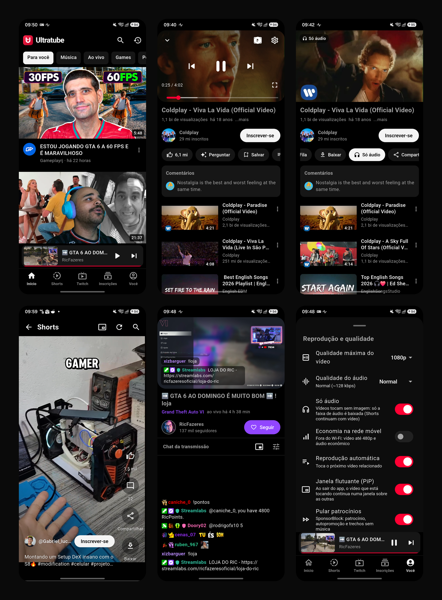
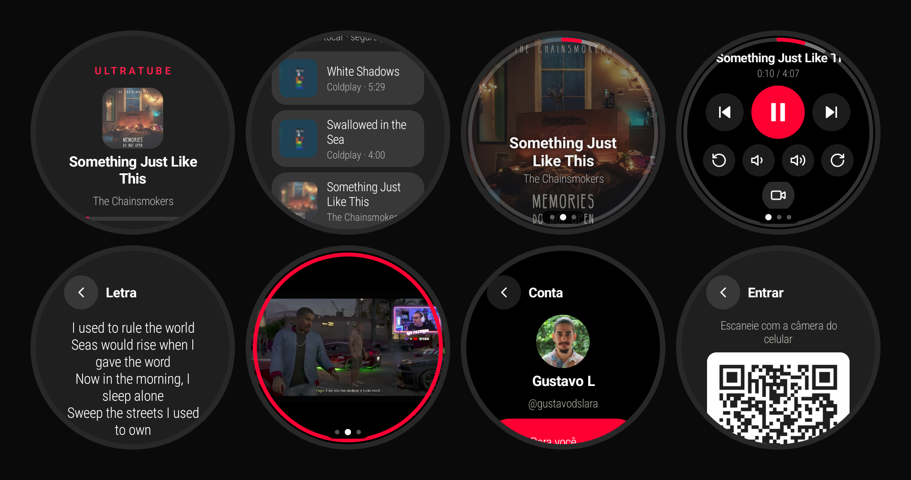

<p align="center">
  
</p>

<p align="center">
  <b>Ad-free YouTube, YouTube Music and Twitch for Android phones and Galaxy Watch / Wear OS.</b><br>
  No Google account required: subscriptions, history, playlists and downloads stay on your device.
</p>

<p align="center">
  <a href="https://github.com/gusdslara/ultratube/releases/latest"></a>
  <a href="https://github.com/gusdslara/ultratube/actions/workflows/ci.yml"></a>
  <a href="LICENSE"></a>
  
</p>

<p align="center">
  
</p>

> **Disclaimer.** Ultratube is an independent, non-commercial project. It is **not affiliated with,
> endorsed or sponsored by YouTube, Google LLC, Twitch or Samsung**. All trademarks belong to their
> respective owners. Ultratube does not host any content; it plays what the services publicly serve.
> Use it in accordance with the laws and terms that apply to you.

## Download

Grab the files from the [latest release](https://github.com/gusdslara/ultratube/releases/latest)
and verify them with `SHA256SUMS.txt` (`sha256sum -c SHA256SUMS.txt --ignore-missing`).

| Platform | File | Status |
|---|---|---|
| Android phone (8.0+, arm64-v8a / x86_64) | `Ultratube-phone-<version>.apk` | Main target, tested on Galaxy S23 (Android 16) |
| Galaxy Watch / Wear OS 3+ | `Ultratube-watch-<version>.apk` | Main target, tested on Galaxy Watch 7 |
| Windows 10/11 x64 | `Ultratube-<version>-windows-x64.zip` | Experimental: extract and run `ppplayer.exe` |
| Linux x64 | `Ultratube-<version>-x86_64.AppImage`, `Ultratube-<version>-linux-x64.tar.gz` | Experimental |
| macOS 11+ (Apple Silicon / Intel) | `Ultratube-<version>-macos.zip` | Experimental, ad-hoc signed |
| iOS / iPadOS | `Ultratube-<version>-ios-unsigned.ipa` | Experimental, unsigned, for sideloading |

The desktop and iOS builds come straight from GitHub Actions and have not been tested on real
hardware yet. Feedback is welcome in [Issues](https://github.com/gusdslara/ultratube/issues).

### Installing

- **Phone**: download the APK on the phone and open it (allow "install unknown apps" for your browser
  or file manager), or `adb install Ultratube-phone-<version>.apk`.
- **Watch**: enable *Developer options › ADB debugging* and *Debug over Wi-Fi* on the watch, then
  `adb connect <watch-ip>:<port>` and `adb install Ultratube-watch-<version>.apk`
  (or use a sideloading app such as *Bugjaeger* / *Wear Installer*).
- **macOS**: unzip, move the app (`PPPlayer.app`, the upstream bundle name) to Applications, then
  right-click › *Open* the first time (or run `xattr -dr com.apple.quarantine` on it).
- **Linux**: `chmod +x Ultratube-*.AppImage && ./Ultratube-*.AppImage`. The tarball needs `libmpv`
  installed from your distribution.
- **iOS**: the `.ipa` is **not signed**. Sign and install it yourself with
  [AltStore](https://altstore.io) / [SideStore](https://sidestore.io), [Sideloadly](https://sideloadly.io)
  (free Apple ID: re-sign every 7 days), [TrollStore](https://github.com/opa334/TrollStore) on supported
  iOS versions, or a jailbroken device.

> **Upgrading from 1.0.7 or older builds:** releases from v1.0.7 on are signed with a new release key.
> Builds shared before (signed with a debug key) cannot be updated in place — uninstall the old app once,
> then install the new APK. Downloads and settings stored by the old build are removed with it.

## Highlights

- **No ads and no YouTube WebView**: its own extraction (NewPipeExtractor + the app client) and an
  mpv-based player on the phone, Media3 on the watch.
- **Real audio-only mode**: only the audio track is downloaded, in economy (~50 kbps), normal or high
  quality.
- **Shorts** from the real YouTube feed (your account's when signed in), with pull to refresh.
- **Ad-free Twitch**: a local HLS proxy strips commercial breaks; chat with 7TV/BTTV emotes.
- **Galaxy Watch both ways**: a standalone watch app that plays on its own (Wi-Fi/LTE) **and** full
  control of the phone app from the watch, queue included.

## Features

### Phone

- **Home**: "For you" (with an account, your YouTube home; without one, subscriptions plus "up next"
  from your history), and Music, Live, Gaming and Podcasts tabs.
- **Search** with suggestions and filters (videos, Shorts, songs, channels, playlists, albums).
- **Watch**: up to 4K, double tap ±10 s, fullscreen, description, comments, "Up next" with autoplay and a
  YouTube-style queue (drag, shuffle, repeat, save as playlist).
- **Audio only**, **audio quality** and **mobile-data saver** (off Wi-Fi: video up to 480p and economy
  audio). In the background without picture-in-picture, video stops downloading and only audio continues.
- **Picture-in-picture** in the video's aspect ratio (vertical for Shorts).
- **Shorts**: vertical feed with preloading, comments, likes, pull down for a fresh feed.
- **SponsorBlock** (sponsors, self-promotion, subscribe reminders).
- **Offline downloads**: M4A audio or 480p/720p/1080p video, with cover art, in the background.
- **YouTube live streams** with chat overlay and viewer count.
- **Twitch**: following (with or without an account, via twitch.tv/activate), live now, categories,
  VODs and chat.
- **Ask (Gemini)**: video summary and explanation with timestamps, using your own Google AI Studio key.
- **Optional YouTube account** (regular Google sign-in page, no API key) and subscription import
  (Google Takeout, NewPipe, LibreTube).
- Lyrics from LRCLIB.

### The watch controlling the phone (no watch app needed)

The phone app publishes a full media session that the Galaxy Watch media controls (and headphones,
car and lock screen) use: artwork, title and channel; play/pause, previous/next, ±10 s and volume;
**the phone's queue shows up on the watch**; Shorts navigation; works with the phone locked in a pocket.

<p align="center">
  
</p>

### Watch app (Galaxy Watch / Wear OS)

- **Standalone**: plays without the phone nearby, with the screen off.
- Voice or text search; Songs · Videos (up to 360p) · Shorts.
- **Shorts** from the real YouTube feed, swiping up/down.
- **YouTube account via the phone**: Wear OS cannot open Google's sign-in page, so the signed-in phone
  sends the session over Wi-Fi, encrypted (QR or code in *You › Connect watch*).
- Ad-free Twitch, YouTube live streams, lyrics, queue, favourites, offline downloads and a sleep timer
  (15–90 min). Ongoing Activity icon on the watch face while playing.

<p align="center">
  
</p>

All screenshots (28 phone, 20 watch, 3 watch-as-remote), the logo and the feature images are in
[`docs/portfolio/`](docs/portfolio/README.md).

## How it works

```
                 ┌──────────────── android/media (Kotlin) ────────────────┐
                 │ Catalog · PlayerFallback · AudioQuality · YoutubeAccount │
                 │ Downloads · Twitch · WatchLink                           │
                 └───────────────┬──────────────────────────┬─────────────┘
                                 │ plugin (MethodChannel)    │ direct calls
          ┌──────────────────────▼──────┐        ┌──────────▼─────────────────┐
          │ Phone — Flutter (ppplayer)  │        │ Watch — Kotlin (wear)       │
          │ MediaKit/mpv · audio_service │  Wi-Fi │ Media3/ExoPlayer · Views    │
          │ media session ───────────────┼───BT──▶│ Galaxy Watch media controls │
          │ "Connect watch" ─────────────┼──AES──▶│ "Sign in with phone"        │
          └──────────────────────────────┘        └────────────────────────────┘
```

Phone (Flutter) and watch (Kotlin) are separate apps, but everything that is not UI lives in one place,
`android/media/`: search, channels, playlists, stream extraction, Shorts, audio track selection,
YouTube account (InnerTube with cookies), the encrypted watch sign-in protocol, lyrics and downloads.
iOS cannot run Kotlin, so `ppplayer/lib/core/api/dart_catalog.dart` and
`ppplayer/lib/core/ultratube/dart_account.dart` are Dart ports that follow the same rules and JSON
formats. Library versions shared by both Gradle builds are in `android/gradle/libs.versions.toml`.

## Repository layout

```
ppplayer/                 phone app (Flutter fork of PPPlayer) — also builds iOS and desktop
android/media/            native library shared by the phone and the watch
android/wear/             Galaxy Watch (Wear OS) app
docs/DIARIO.md            development log (Portuguese)
docs/portfolio/           screenshots, logo and feature images
.github/workflows/        CI, desktop, iOS and release workflows
```

The phone's Android build includes `android/media` as a Gradle module
(`ppplayer/android/settings.gradle.kts`), so both folders must stay side by side.

## Building from source

Requirements: Flutter 3.47 (Dart ≥ 3.12), **JDK 17** (the watch's Gradle does not run on JDK 25) and
Android SDK 35.

```sh
# phone
cd ppplayer
flutter pub get
flutter build apk --release

# watch
cd android
./gradlew :wear:assembleRelease
```

Release signing: create `ppplayer/android/key.properties` and/or `android/key.properties` with
`storeFile`, `storePassword`, `keyAlias` and `keyPassword` (never committed). Without them, release
builds fall back to the debug key. On Windows, `flutter pub get` needs Developer Mode (symlinks).

Desktop and iOS builds run on GitHub Actions: *Ultratube Desktop* and *Ultratube iOS (unsigned IPA)*
can be started manually, and pushing a `v*` tag runs the *Release* workflow, which builds every
platform and attaches the files and `SHA256SUMS.txt` to the GitHub Release.

## Known limitations

- Playing from the watch/headphones **while the app has been killed by the system** does not start
  yet: the Flutter engine resolves the stream, but mpv only finishes initialising with the app's
  screen. With the app open or in the background (the normal case) it works, phone locked included.
- Some Shorts come back unavailable in NewPipeExtractor v0.27.1 and are skipped.
- Phone and watch share the same YouTube session; if Google rotates the cookies on one, the other may
  need to reconnect.
- Twitch only lists the top 30 live channels in "Live now" without an integrity token.
- The UI is in Portuguese (pt-BR).
- Not tested yet: Ask with a real key, battery/Bluetooth on the watch, iOS and desktop.

## Credits

- Phone app forked from **[PPPlayer](https://github.com/ppplayer-labs/app)** (MIT), commit `6cea891`.
  Ultratube removed its ads (Google Mobile Ads and the YouTube player/WebView, replaced by its own
  extraction + MediaKit) and added everything described above. The watch app and `android/media` are new code.
- **[NewPipeExtractor](https://github.com/TeamNewPipe/NewPipeExtractor)** (GPL-3.0),
  **[media_kit](https://github.com/media-kit/media-kit)** / **[mpv](https://mpv.io)**,
  **[AndroidX Media3](https://github.com/androidx/media)**, **[SponsorBlock](https://sponsor.ajay.app)**,
  **[LRCLIB](https://lrclib.net)**, **[7TV](https://7tv.app)** and **[BetterTTV](https://betterttv.com)**.
- Full list with licenses: [`THIRD_PARTY_NOTICES.md`](THIRD_PARTY_NOTICES.md).

## License

[GPL-3.0](LICENSE). New code in `android/` and the combined Android/Wear distribution are
GPL-3.0-or-later (they link NewPipeExtractor, GPL-3.0); see `android/NOTICE.md`. `ppplayer/` keeps the
PPPlayer notice in `ppplayer/assets/LICENSE` and the fork notes in `ppplayer/ULTRATUBE-NOTICE.md`.
The corresponding source for every released binary is the tagged commit in this repository.

Leia em português: [README.pt-BR.md](README.pt-BR.md).
